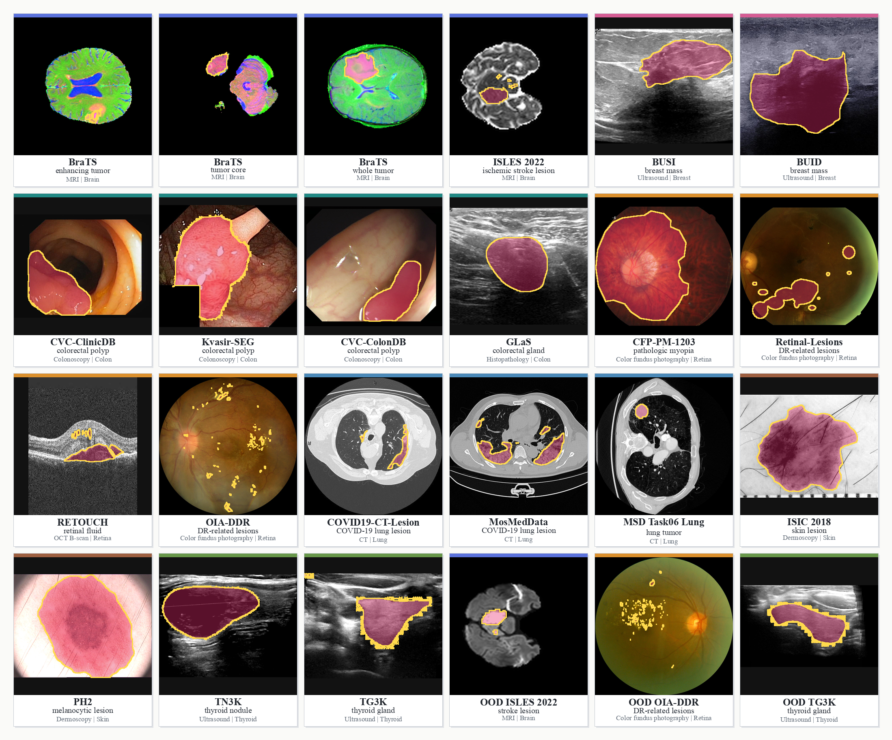

# FAME

Official evaluation code for **FAME**, a lesion-focused benchmark for few-shot lesion segmentation with large-model methods.

FAME covers 17 public datasets, 7 anatomical sites, 7 imaging modalities, 14 lesion segmentation tasks, and 13,188 test samples. Tasks are organized into four lesion subsets (Small, Medium, Large, Scatter), and 34 methods (27 large-model methods plus 7 conventional baselines) are compared under one protocol with two metrics: positive-case Dice and negative-image specificity.

Dataset: https://huggingface.co/datasets/Kimokcheon/FAME_benchmark  
Paper: https://arxiv.org/abs/2607.27856

If you use FAME, please cite the paper and the third-party methods you run. See [Citation](#citation) and [Third-Party Methods](#third-party-methods).



## What Is Included

This repository contains the public evaluation interface used for the released FAME benchmark:

- loading the Hugging Face FAME protocol archive;
- materializing image and mask pixels from Parquet shards;
- reading IID few-shot, zero-shot, and OOD episodes;
- evaluating predicted binary masks with FAME metrics;
- collecting per-task summaries into method-level tables;
- bundled runners for the re-run SAM-family, CLIP-head, and universal few-shot methods in `scripts/methods/`;
- minimal STAMP-2B and MedSAM3 example entrypoints.

It intentionally does not include local experiment queues, private paths, checkpoints, raw source data, cached predictions, or exploratory ablation scripts.

## Benchmark Protocol

FAME follows the public dataset release at `Kimokcheon/FAME_benchmark`.

- **Zero-shot IID:** evaluate each target task without support masks.
- **Few-shot IID:** use the released positive support image-mask pairs for each target task.
- **OOD:** use source-task support masks and evaluate under covariate or semantic shift.

The paper reports one-shot (K=1) as the primary setting, with K in {1, 5, 10} and five fixed support groups. The public release provides the `k10_seed0` episodes; the bundled single-support runners therefore use support index 0 by default and can switch groups with `--support-index`.

Positive cases report Dice. Target-absent negative cases report image-level specificity:

```text
Spe. = TN / (TN + FP)
```

A target-absent image is a true negative if the predicted mask is empty and a false positive if the predicted mask contains any foreground region.

## Install

```bash
git clone https://github.com/Kimokcheon/FAME.git
cd FAME
python -m venv .venv
source .venv/bin/activate
pip install -r requirements.txt
```

## Download FAME

Protocol-only download:

```bash
python scripts/download_fame.py --local-dir data/FAME_benchmark --protocol-only
```

Full download with image and mask pixels:

```bash
python scripts/download_fame.py --local-dir data/FAME_benchmark
python scripts/extract_pixels.py --root data/FAME_benchmark
```

After extraction, the JSON/JSONL protocols are under:

```text
data/FAME_benchmark/FAME_benchmark/
```

The raw images and masks referenced by the JSONL files are under:

```text
data/FAME_benchmark/data/benchmark_dataset/
data/FAME_benchmark/data/benchmark_dataset_ood/
```

## Evaluate Predictions

Write one binary mask per query image. The default filename is `<case_id>.png`, but `.npy`, `.npz`, `.png`, `.jpg`, `.jpeg`, `.tif`, `.tiff`, and `.bmp` are accepted.

Example for one IID 10-shot task:

```bash
python scripts/evaluate_predictions.py \
  --test-jsonl data/FAME_benchmark/FAME_benchmark/episodes/k10_seed0/ISIC2018__ISIC2018_skin_lesion/test.jsonl \
  --pred-dir outputs/MyMethod/ISIC2018__ISIC2018_skin_lesion/pred_masks \
  --out-dir outputs/MyMethod/ISIC2018__ISIC2018_skin_lesion/eval \
  --method MyMethod \
  --task ISIC2018__ISIC2018_skin_lesion \
  --release-root data/FAME_benchmark
```

Outputs:

```text
per_case_metrics.csv
summary_all.csv
```

Evaluate a whole IID split:

```bash
python scripts/evaluate_split.py \
  --release-root data/FAME_benchmark \
  --prediction-root outputs/MyMethod/predictions \
  --output-root outputs/MyMethod/eval \
  --setting k10_seed0 \
  --method MyMethod
```

Evaluate OOD pairs:

```bash
python scripts/evaluate_ood.py \
  --release-root data/FAME_benchmark \
  --prediction-root outputs/MyMethod_ood/predictions \
  --output-root outputs/MyMethod_ood/eval \
  --method MyMethod
```

Collect summaries:

```bash
python scripts/collect_summaries.py \
  --eval-root outputs/MyMethod/eval \
  --out-csv outputs/MyMethod/result_long.csv
```

## Example Method Entrypoints

The example scripts are thin wrappers. Install the official method repository and checkpoint separately, then make the method write binary masks into the expected `pred_masks/` directory.

STAMP-2B example:

```bash
export FAME_RELEASE=data/FAME_benchmark
export STAMP_ROOT=/path/to/STAMP
export STAMP_CKPT=/path/to/stamp-2b
export TASK=ISIC2018__ISIC2018_skin_lesion
bash scripts/examples/run_stamp2b_example.sh
```

MedSAM3 example:

```bash
export FAME_RELEASE=data/FAME_benchmark
export MEDSAM3_ROOT=/path/to/MedSAM3
export MEDSAM3_CKPT=/path/to/medsam3_checkpoint
export TASK=ISIC2018__ISIC2018_skin_lesion
bash scripts/examples/run_medsam3_example.sh
```

These examples show the FAME input/output contract. Exact model training and inference commands should follow the official repositories of the corresponding methods.

## Bundled Method Runners

`scripts/methods/` adapts the re-run methods to the FAME episode interface. Each runner writes one binary mask per query case to `<out-root>/<task>/pred_masks/<case_id>.png`, so the output can be scored directly with `scripts/evaluate_split.py`.

| Runner | Methods |
| --- | --- |
| `run_sam_family.py` | SAM, MedSAM, MobileSAM, SAM 2.1, MedSAM2 |
| `run_sam_mpa.py` | SAM-MPA, MedSAM-MPA |
| `run_matcher.py` | Matcher |
| `run_gfsam.py` | GF-SAM |
| `run_clip_head.py` | MaskCLIP, SCLIP, ProxyCLIP |
| `run_sansa.py` | SANSA |
| `run_tyche.py` | Tyche |
| `run_universeg.py` | UniverSeg |
| `run_unet.py` | Episodic U-Net |

Example with Matcher:

```bash
python scripts/methods/run_matcher.py \
  --release-root data/FAME_benchmark \
  --setting k10_seed0 \
  --tasks ISIC2018__ISIC2018_skin_lesion \
  --out-root outputs/Matcher/predictions \
  --matcher-root /path/to/Matcher \
  --sam-checkpoint /path/to/sam_vit_h.pth \
  --dinov2-checkpoint /path/to/dinov2_vitl14.pth

python scripts/evaluate_split.py \
  --release-root data/FAME_benchmark \
  --prediction-root outputs/Matcher/predictions \
  --output-root outputs/Matcher/eval \
  --method Matcher
```

The runners need PyTorch and, for the registration-based SAM adapters, OpenCV:

```bash
pip install torch torchvision opencv-python-headless scipy
```

Install each official method repository and checkpoint separately. Use `python scripts/methods/<runner>.py --help` for the method-specific paths.

## Directory Layout

```text
fame_eval/
  protocol.py      # FAME protocol and episode loaders
  metrics.py       # Dice and image-level specificity
  evaluate.py      # prediction-folder evaluation
  collect.py       # summary collection
scripts/
  download_fame.py
  extract_pixels.py
  evaluate_predictions.py
  evaluate_split.py
  evaluate_ood.py
  collect_summaries.py
  examples/
  methods/
    _common.py             # FAME episode adapter and registration helpers
    run_*.py               # method-specific runners
docs/
  METHODS.md
  THIRD_PARTY.md
```

## Third-Party Methods

FAME evaluates similarity-based, prompt-based, and interaction-based methods, together with conventional baselines. We thank the authors of the public repositories listed in [docs/THIRD_PARTY.md](docs/THIRD_PARTY.md).

When reporting a result for a third-party method, cite the FAME paper and the original method paper/repository.

## Citation

```bibtex
@misc{liu2026benchmarkinglargemodelmethods,
      title={Benchmarking Large-Model Methods for Few-Shot Lesion Segmentation},
      author={Jinghong Liu and Yuchuan Deng and Fanping Liu and Meng Huang and Xirong Li},
      year={2026},
      eprint={2607.27856},
      archivePrefix={arXiv},
      primaryClass={cs.CV},
      url={https://arxiv.org/abs/2607.27856},
}
```

